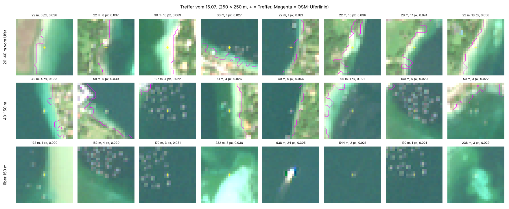
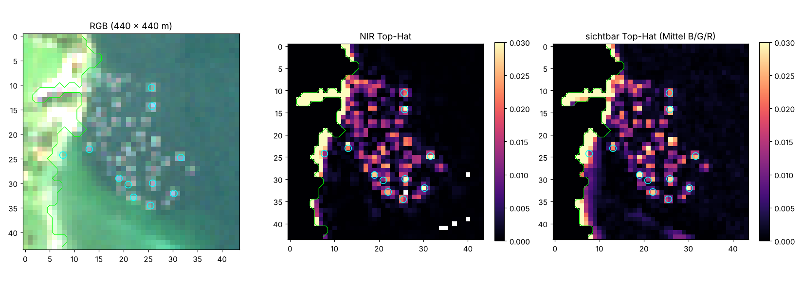
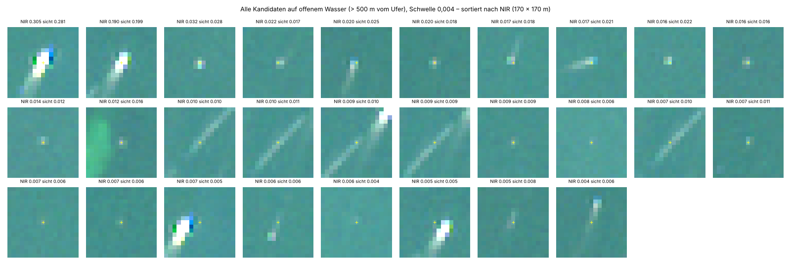
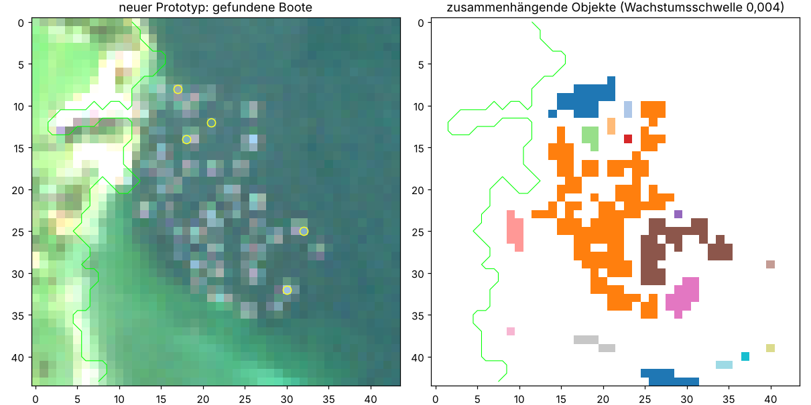
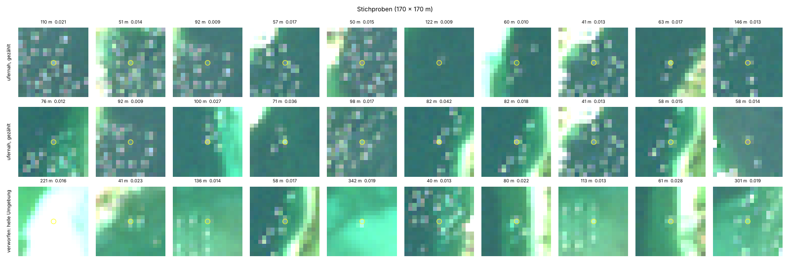
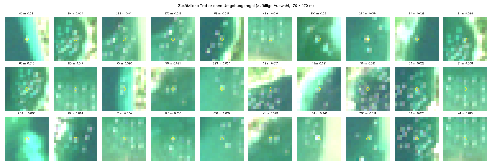
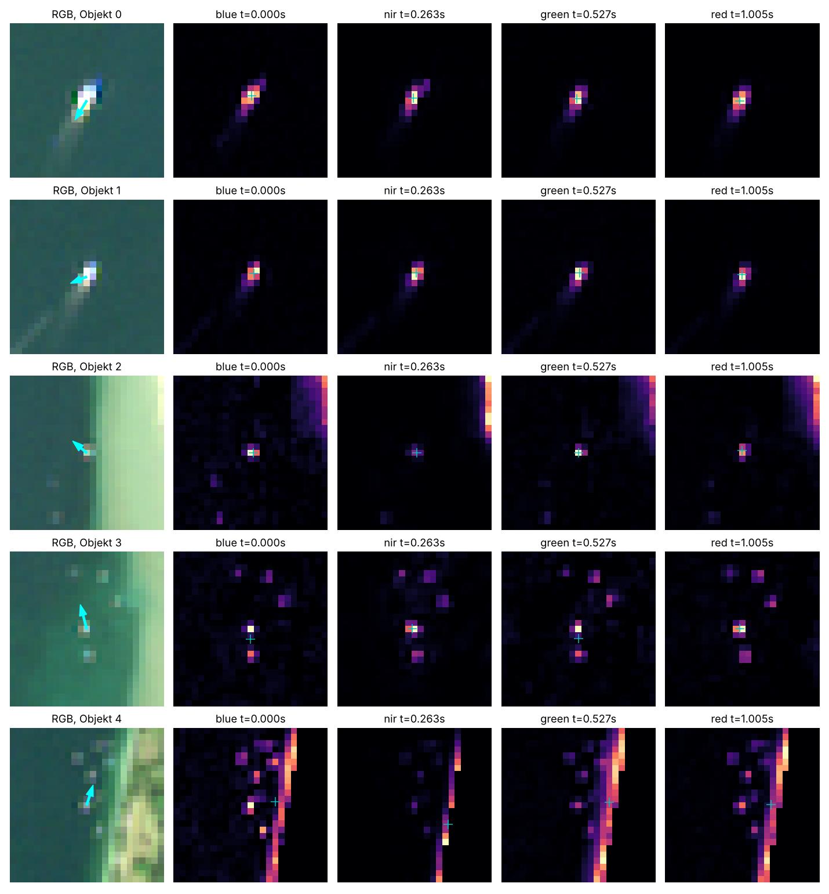
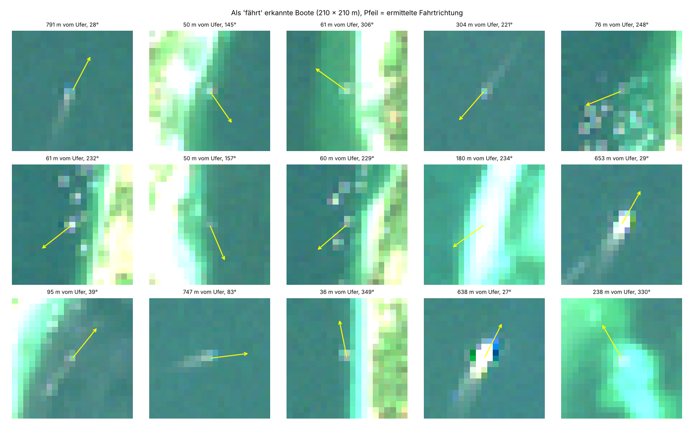

# Kalibrierung an echten Daten: Starnberger See, 16.07.2026

Grundlage: Sentinel-2C, Szene `S2C_T32UPU_20260716T100555_L2A`, 10:17 UTC, wolkenlos. Die Rohdaten liegen in [`daten/`](../daten/). Jeder Schritt hier wurde an diesen Pixeln gemessen und mit dem Satellitenbild verglichen.

## 1. Was die alte Version (133 Treffer) falsch gemacht hat

- **Uferstreifen:** 60 von 133 Treffern lagen 20–40 m vom Ufer auf einem hellen, sehr flachen Uferstreifen. Die OSM-Uferlinie (magenta) liegt landseitig davon. Das waren Mischpixel, keine Boote.
- **Bojenfelder:** Hier liegen viele Boote als regelmäßige Punkte, gefunden wurden nur einzelne.

## 2. Wie hell sind Boote, wie stark rauscht das Wasser?

- **Wasser:** Im nahen Infrarot (B08) sehr dunkel, Median 0,009. Das Rauschen ist winzig: 99,9 % der Top-Hat-Werte auf offenem Wasser liegen unter 0,003.
- **Boote im Bojenfeld:** Kontrast 0,01–0,04 im Infrarot und genauso im sichtbaren Licht. Die alte Mindestschwelle von 0,02 war viel zu hoch.

## 3. Schwelle auf offenem Wasser

Alle Kandidaten mehr als 500 m vom Ufer (32 km²), sortiert nach Helligkeit:

- **Plateau:** Zwischen den Schwellen 0,006 und 0,008 bleiben stabil etwa 17 Punkte.
- **Bildprüfung:** 13 davon sind echte Boote, auch Boote mit Kielwasser.
- **Fehlalarme:** 4 sind alte Kielwasserspuren (lange Linien ohne Kopf), weitere sind Nebenmaxima im Kielwasser oder Rauschen.

Gewählt: Infrarot ab 0,008 **und** sichtbares Licht ab 0,006. Lange Linien ohne hellen Kopf zählen nicht.

## 4. Boote zählen statt Objekte

In dichten Bojenfeldern wachsen die Boote zu einem großen Objekt zusammen (hier 135 Pixel). Deshalb zählt jede Spitze, also jeder einzelne helle Punkt mit dunklerem Wasser drumherum. Im Feld: 34 Spitzen bei etwa 35 sichtbaren Booten.

## 5. Ufernahe Treffer und helle Umgebung

- **Ufernahe Treffer:** Fast alle liegen in Bojenfeldern.
- **Regel „helle Umgebung“:** Sie hat viele echte Boote über hellem Flachwasser verworfen und wurde gestrichen. Dadurch kamen etwa 25 Boote und 5 Fehltreffer an hellen Uferstreifen hinzu, also etwa jeder sechste.

Gesamtergebnis: [Übersicht Nord](bilder/k09_uebersicht_neuer_detektor_nord.jpg), [Übersicht Süd](bilder/k09_uebersicht_neuer_detektor_sued.jpg).

## 6. Fahrt, Richtung, Geschwindigkeit

- **Aufnahmezeiten:** Sentinel-2 nimmt die 10-m-Kanäle nacheinander auf: B02 bei 0 s, B08 bei 0,263 s, B03 bei 0,527 s, B04 bei 1,005 s (Heiselberg 2019, *Sensors* 19:2873). Ein fahrendes Boot erscheint deshalb in jedem Kanal leicht versetzt.
- **Richtung:** Bei beiden hellen Booten zeigte der Versatz genau entlang des Kielwassers, aber um 180° verdreht. Je nach Detektor kehrt sich die Kanalreihenfolge um. Die Richtung kommt deshalb aus dem Kielwasser, der Versatz liefert nur die Geschwindigkeit.
- **Geschwindigkeit:** Mit 50 % Kernschwelle wurden künstliche Schiffe um bis zu 15 km/h falsch gemessen, mit 20 % auf etwa 2 km/h genau. Ergebnis für die echten Boote: etwa 20 und 19 km/h.

Von 15 zunächst als „fährt“ erkannten Booten hatten 6 echtes Kielwasser. Die anderen 9 lagen am Ufer, in Bojenfeldern oder auf Flachwasser. Nach den Regeln „weißes Kielwasser“, „ab 80 m vom Ufer“ und „nicht im Bojenfeld“ bleiben genau die 6 echten.

## Ergebnis
**298 Boote** (232 ufernah, 66 offener See), Qualität „gut“. Mit `--empfindlichkeit` 0,8 bzw. 1,3 sind es 283 bzw. 316, die Zahl ist also stabil.
